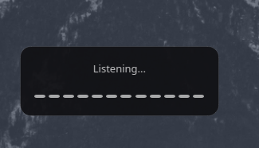
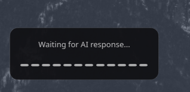
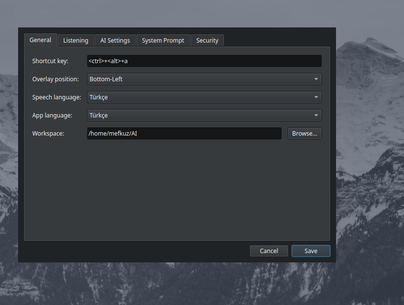
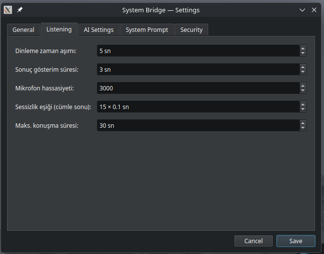
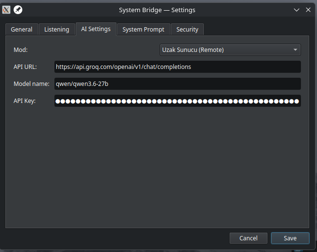
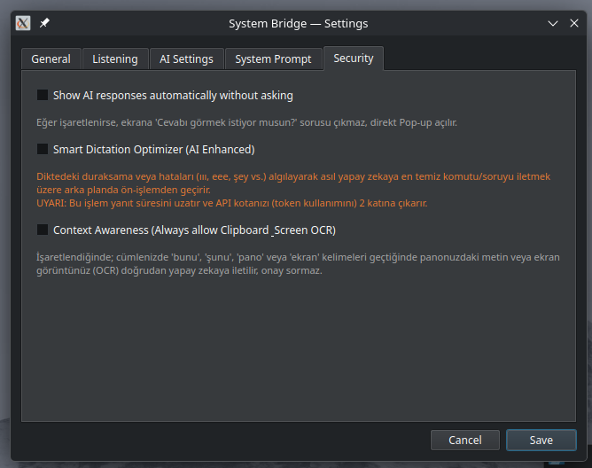

# Linux AI Assistant

A highly configurable, context-aware voice assistant and system bridge designed exclusively for Linux desktop environments.

While there are many AI assistants available for Windows and macOS, Linux power users often lack a deeply integrated, native tool that respects the Linux ecosystem. Linux AI Assistant bridges this gap by offering a seamless overlay interface, robust context awareness (screen OCR and clipboard reading), and flexible API support, all while remaining completely unobtrusive to your workflow.

## Key Features

- **Unobtrusive Overlay UI:** Operates in the background with a minimal, non-blocking overlay that stays out of your way.
- **Tool Calling (NEW!):** In Remote/Local API modes and Codex terminal mode the AI can use 13 function tools on its own — run shell commands, read/write/append files, read your screen (OCR) and clipboard, check the active window, control the browser/desktop (tabs, scrolling, forms, clicks, key presses — works with or without the browser extension), and search/read the web (DuckDuckGo, no API key). Dangerous commands and sensitive reads ask for confirmation first.
- **Conversation Memory (NEW!):** The AI remembers the last N dialogue turns (configurable, default 6). Follow-ups like "add that to the file you just opened" work naturally. Clear it anytime from the tray menu.
- **Zero-Token Request Logs (NEW!):** Every request is automatically logged to `Loglar/YYYY-MM-DD-<request>-log.md` by the PC itself — the AI no longer spends tool calls and tokens on logging. Toggleable in Settings → Security.
- **Browser Extension Integration:** A two-way communication bridge that lets the AI read your Gmail, PDFs, and YouTube videos, and lets you voice-control the browser (scroll, close tabs, auto-fill forms, click buttons, press keys). Even without the extension, the AI can control tabs, scrolling, typing, clicks and key presses at OS level (Wayland + X11).
- **Context Awareness:** Can instantly read your clipboard and perform OCR on your screen (using native Linux tools like Grim, Spectacle, or Gnome-Screenshot) to provide context to the AI.
- **Universal Linux Support:** The installer handles dependencies seamlessly across Arch, Debian/Ubuntu, Fedora, and openSUSE.
- **Flexible LLM Integration:** Connect to local models (e.g., LM Studio, Ollama), remote APIs (e.g., Groq, OpenAI, OpenRouter), or CLI-based AI tools.
- **Bilingual Interface:** Supports both English and Turkish application languages out of the box.
- **Auto-Updates (NEW!):** Checks GitHub Releases on startup, shows release notes, and updates with one click (fast-forward `git pull` + dependency refresh).

## Updates

On startup the app quietly checks the [latest GitHub Release](https://github.com/mefkuz/Linux-AI-Assistant/releases/latest). When a newer version exists, a dialog shows the **release notes** with options: **Update Now**, **Later**, or **Skip This Version**. "Update Now" runs a fast-forward `git pull`, refreshes Python dependencies, and offers to restart. You can also check manually via **Tray menu → Check for Updates** or **Settings → Updates**, or disable the startup check there.

Notes for non-git installs (ZIP download): in-place update isn't possible — the dialog's **Open Release Page** button takes you to the manual download instead.

## Tool Calling

When **Tool Calling** is enabled (Settings → Security, active in Remote/Local API modes and Codex terminal mode), the model receives 13 function tools and calls them as needed — no keywords required:

| Tool | What it does |
|---|---|
| `run_shell_command` | Runs a Linux terminal command (stdout + stderr + exit code) |
| `read_file` / `write_file` / `append_file` | Read, overwrite, or append to text files (workspace-restricted) |
| `list_directory` | Lists folder contents |
| `read_screen_text` | Screenshots the screen and reads it via OCR |
| `get_clipboard_text` | Reads the clipboard |
| `get_active_window_context` | Lists the active window / media player context |
| `browser_action` | Controls the browser/desktop (new/close tab, scroll, fill form, click button or coordinate, press key — extension preferred, OS-level fallback) |
| `web_search` | Searches the web (DuckDuckGo, no API key): titles + URLs + snippets |
| `fetch_web_page` | Downloads a page as clean text (menus/ads stripped, query-focused trim) |
| `ask_openclaw` | Sends a task to the configured OpenClaw gateway (when enabled) |
| `ask_user` | Asks a clarification question, with optional choices and a free-text answer |

Token-frugal by design: tool schemas are kept short, search snippets are capped (~200 chars each), fetched pages are trimmed to ~4000 chars with question-relevant paragraphs picked locally in Python (zero LLM tokens) instead of dumping whole pages into context.

**Safety model (3 layers):**
1. Sensitive reads (screen/clipboard) ask for confirmation every time unless you allow them in settings.
2. File writes and command execution ask only if you enable "ask before running tools".
3. Dangerous shell commands (`rm`, `sudo`, …) always ask for confirmation, even with confirmations off — file tools can never silently escape the workspace, and any attempt to read/write outside the assigned workspace (via file tools or shell paths like `cat /etc/passwd`) raises a dedicated red **workspace-escape dialog** (one-time allow or block) instead of a plain confirm box.

Every tool call is logged to `Loglar/araclar-YYYY-MM-DD.md`, and models/servers that don't support the `tools` parameter automatically fall back to plain chat.

## Codex terminal integration

Install OpenAI Codex CLI and authenticate with `codex login`. This integration was verified with `codex-cli 0.169.0`; it requires an app-server version supporting experimental dynamic tools. It uses your Codex login and does not require the app's remote API key.

In **Settings → AI → Terminal (CLI) → AI Tool**, select **codex (OpenAI)** and save. Leave Model empty to use your Codex default, or enter a model available to your account. The optional extra arguments support `-c model_reasoning_effort=low`, `-c model_verbosity=low`, and `-c service_tier=default`. Permission and transport overrides are rejected.

For a terminal chat session:

```bash
./venv/bin/python main.py --ai codex --workspace /path/to/project
# Optional: --model <model-available-to-your-account>
```

The terminal reads saved settings; these command-line overrides apply only to the current session. The GUI continues to use the saved provider. To use Codex for voice commands, select it in Settings.

Codex receives the **same 13 tool schemas** as the HTTP API and calls the **same ToolExecutor**: file read/write/append/list, shell, screen OCR, clipboard, active window, browser/desktop control, web search, page reading, and OpenClaw. Screen/clipboard approval, workspace escape approval, write/command confirmation settings, browser extension routing and OS fallback, and tool/request logs are shared. Conversation memory, context attachments, response display markers and internal dictation/analysis calls use the existing application pipeline. OpenClaw still requires its own configured endpoint and enable switch.

Each request starts an ephemeral Codex thread with the app's bounded conversation history. Clear Memory clears subsequent Codex context too. Internal dictation calls receive no tools or history. Native shell/image tools, web search and unrelated MCP servers are disabled; native action approvals are declined so actions go through the application's permission checks. No permission-bypass flag is used. Model generation has a configurable `codex_timeout` (default 180 seconds); time spent in application tools/confirmation dialogs is excluded. Subprocesses are stopped and reaped after success or failure. Model/login/protocol failures are shown explicitly, without silently switching provider.

Verification:

```bash
./venv/bin/python tests/test_codex.py -v
./venv/bin/python -m unittest discover -s tests -v
# Opt-in: uses the authenticated Codex model; may consume account usage.
./venv/bin/python tests/manual/test_codex_live.py
```

The live test requires the model to invoke all 13 tools. File and shell operations run in a temporary workspace; desktop, web and OpenClaw I/O use fixtures while their real application handlers and permission checks run. Physical microphone/OCR availability, browser extension connection and external service availability still depend on your Linux session, as they do in API mode.

## Clarification questions (API and Codex)

When an instruction lacks information needed to carry it out, the AI can call `ask_user` and wait for your answer. This works in Remote/Local API modes and Codex terminal mode while Tool Calling is enabled.

The model is instructed to call `ask_user` for clarification rather than writing the question as a final response. A conservative fallback also recognizes short direct clarification replies (such as “Neyi kastettiniz?”), opens the same question dialog and continues with the answer. Ordinary explanations containing question marks are kept as responses. Codex continues in the same thread so its previous context and tools are preserved.

The GUI uses the same native dialog layout as the existing confirmation windows. Select an offered answer (up to six choices), optionally add text or dictate extra details, then press Send. Selecting an option never submits it; changing the option preserves the text you have written. You can also answer with text alone. Nothing is selected or submitted automatically. Closing the window or pressing Cancel stops the request and its remaining tool actions. The overlay reports cancellation instead of success. Questions do not trigger a second permission dialog; file/command permissions continue to apply separately.

The AI can attach **local images or a screenshot** to its question using `ask_user.image_paths` or `ask_user.screenshot`. Local paths follow workspace permissions, and screenshots require the existing screen-reading permission. The AI cannot draw annotations. Users cannot add their own images or screenshots in the question dialog.

On an AI-provided image, choose **Mark up** to circle, box or point to a region and optionally label it. Choose **Use marks**, say or type “here”, then press **Send** yourself. Your marks appear blue. Undo, Clear and Cancel are available; originals are preserved. Enlarge opens a full-resolution preview without submitting. Up to four images are supported (PNG, JPEG, WebP, BMP or the first GIF frame), capped at 8 MB and 16 million pixels each. Screenshot files are private and temporary; remote image URLs are not fetched.

The question window stays uncluttered: there is no image-mode checkbox or OCR explanation. The large markup editor contains a short vision-model note. Marking and choosing **Use marks** prepares the annotated copy; only **Send** transmits it with the reply. A plain answer without marks does not upload the image. API servers that reject images retry with OCR and coordinates. Image payloads stay out of tool-result text and conversation memory; submitted OCR text can enter enabled memory.

Within a tool request, screen OCR and a subsequent screenshot question share the same captured image. The cache is private to that request and cleared after the question or an action that may change the screen. A markup-only question can capture directly without an extra OCR call. Questions, choices and image attachments are requested only when needed to resolve missing information; the model is instructed to continue directly when the existing context is sufficient.

The question dialog also has a **microphone icon**. Click it, speak, then pause: the transcript is inserted into the answer field, preserving the other text. It is **never submitted automatically**; edit it if needed and press Send. During recording, the icon becomes a stop button that cancels voice input. Closing the question stops recording and discards late transcription results. Microphone or speech-service failures are shown in the same dialog and leave typing available. Voice answers use the existing speech language and speech-recognition service; no new dependency is required.

In terminal chat, type an option number or your own text. Selecting a number opens an optional details prompt; press Enter there to send the choice with any details, or `/cancel` to cancel. `/cancel`, Ctrl+C or end-of-input cancels the question. End-of-input also exits terminal chat cleanly.

The answer is returned to the model so it can continue the task. When conversation memory is enabled, clarification answers are included in the stored user turn so follow-ups can use them; Clear Memory removes them. Internal dictation cleanup has no tools and cannot open questions. If an API response batches a question with prewritten actions, those actions are deferred until the model has seen the answer and generates updated calls.

For example, asking to create a note while leaving its filename unspecified lets the model ask for the name before writing the file. Cancelling that question leaves the file unchanged.

```bash
./venv/bin/python tests/test_questions.py -v
./venv/bin/python tests/test_question_voice.py -v
./venv/bin/python tests/test_question_images.py -v
./venv/bin/python tests/test_image_annotations.py -v
# Opt-in live tests: real Codex and saved API; temporary files, no visible windows.
./venv/bin/python tests/manual/test_questions_live.py
./venv/bin/python tests/manual/test_question_images_live.py
./venv/bin/python tests/manual/test_annotated_answers_live.py
```

## Conversation Memory

The assistant keeps the last N question-answer turns (Settings → Security → "Conversation turns to remember", 0 = off) and sends them with each request, in all three LLM modes. Internal calls (CLI output analysis, dictation cleanup) never pollute the history. Use **Tray menu → Clear Memory** to start fresh.

## Request Logs

Every request (CLI command or natural-language question) is automatically logged to `Loglar/YYYY-MM-DD-<request>-log.md` — written locally by the app itself with **zero tokens**, so the AI never wastes tool calls on logging. Each file records the date, request, route (cli/llm), tools used, and a response summary. Say "don't log this" ("log tutma") to skip a single request, or disable logging entirely in **Settings → Security → Logging**.

## Browser Extension Integration

The **Manifest V3 Browser Extension** (compatible with Chrome, Brave, and Edge) takes the AI's context awareness to the next level. It works in both directions:

- **Browser → AI (context):** Click "Send This Tab" (or right-click selected text → "Ask Linux AI Assistant") to inject the page into the AI's context. Gmail threads, PDFs, and articles are extracted as clean text; YouTube videos automatically resolve to their full transcript.
- **AI → Browser (control):** Voice commands like "Close this tab", "Scroll down", "Click the Send button", or "Reply to this email with a polite rejection" are executed through the `browser_action` tool — the AI drafts the reply and injects it directly into your Gmail compose box or any active web form. When the extension isn't connected, the same actions fall back to OS-level automation (`ydotool`/`xdotool`/`pynput`), and clicks can target on-screen text found via OCR.

The extension talks to the app over `http://127.0.0.1:8765` (local only, never leaves your machine).

**Installation (Chrome / Brave / Edge):**
1. Navigate to `chrome://extensions/` (or `edge://extensions/`) in your browser.
2. Enable **Developer mode** in the top right.
3. Click **Load unpacked** in the top left.
4. Select the `extensions/chrome` folder located inside this repository.
5. Pin the microphone icon to your toolbar!

**Installation (Firefox):**
🚧 Planned — not yet available. Tracked for a future release.

## Screenshots

### Main Interface

When triggered via your custom global hotkey, the minimal listening overlay appears. It provides visual waveform feedback for your voice and auto-closes when the interaction is finished.





### Configuration & Settings

Linux AI Assistant is highly customizable, putting the control entirely in your hands.

**General Settings**
Configure your global hotkey and choose the application language.


**Listening & Overlay Settings**
Fine-tune microphone sensitivity, pause detection thresholds, and the physical position of the overlay.



**AI & API Configuration**
Easily switch between local AI instances, remote APIs, and command-line LLM tools.


**Security & Advanced Settings**
Control the permissions of the AI: automatic popup responses, dictation optimization, screen/clipboard reading permissions, Tool Calling toggles, and conversation memory size.


## Installation

The project includes an intelligent installer script that automatically detects your Linux distribution and installs the required system packages, sets up a secure Python virtual environment (venv), and creates desktop/autostart shortcuts.

1. Clone the repository:
   ```bash
   git clone https://github.com/mefkuz/Linux-AI-Assistant.git
   cd Linux-AI-Assistant
   ```

2. Make the installer executable and run it:
   ```bash
   chmod +x scripts/install.sh
   ./scripts/install.sh
   ```

3. Launch the application:
   You can find **Linux-AI-Assistant** in your application launcher, or start it directly from the terminal:
   ```bash
   ./venv/bin/python app.py
   ```
   For a terminal-only chat session without the GUI:
   ```bash
   ./venv/bin/python main.py
   ```

4. (Optional) Run the test suite:
   ```bash
   python3 tests/test_tools.py
   ```

### 🎯 Wayland & Global Hotkeys
If you are using a modern Wayland compositor (like GNOME Wayland or Hyprland), traditional global hotkeys (via pynput) might be blocked by the OS for security reasons.
You can easily bypass this by mapping a custom keyboard shortcut in your OS settings to the following command:
```bash
/path/to/Linux-AI-Assistant/venv/bin/python /path/to/Linux-AI-Assistant/app.py --trigger
```
This safely signals the background process to instantly wake up and start listening, making it 100% compatible with any Linux environment!

## Requirements & Dependencies

The `scripts/install.sh` script installs these automatically depending on your distribution (pacman, apt, dnf, or zypper):
- Python 3.10+
- `portaudio` (for PyAudio)
- `tesseract` & `tesseract-ocr` language packs (for screen context reading)
- A screenshot utility (`grim` for Wayland, `spectacle` for KDE, or `gnome-screenshot` for GNOME/GTK)
- XCB libraries (for PyQt6 compatibility)
- Optional (extension-free desktop control): `ydotool` (+ `ydotoold` service), `xdotool`, `wl-clipboard` (`wl-copy`/`wl-paste` on Wayland), `xclip` (X11) — the installer adds these best-effort; the app auto-falls back to `pynput` when they're missing

## Security & Privacy

- **API Keys are local:** All settings and API keys are stored locally in a `settings.json` file. This file is intentionally ignored in `.gitignore` to prevent accidental uploads.
- **You are in control:** The system prompt is fully exposed in the settings, allowing you to explicitly define how the AI behaves and what rules it follows.
- **Permission checks:** Screen/clipboard reading asks for confirmation every time unless explicitly allowed; dangerous shell commands always require confirmation; file tools and shell paths are jailed to the workspace directory — escape attempts trigger a dedicated red warning dialog instead of a normal confirm box.
- **Local-only browser bridge:** The extension communicates over `127.0.0.1` only — page contents never leave your machine except to your chosen LLM API.

## Project Structure

```
Linux-AI-Assistant/
├── app.py              # GUI entry point (overlay, settings, tray)
├── main.py             # Terminal-only chat session (no GUI)
├── src/                # Application code
│   ├── gui/            # Overlay UI, settings window, waveform
│   ├── audio/          # Microphone listener, global hotkeys
│   ├── llm/            # Router, API client, CLI tools
│   ├── tools/          # Tool Calling schemas + executor
│   ├── context/        # Active-window context, extension bridge (:8765)
│   └── core/           # Settings, security, i18n, updater, version
├── extensions/         # Browser extension (chrome/)
├── tests/              # test_tools.py, test_os_input.py, test_updater.py + manual/ sandbox scripts
├── scripts/            # install.sh
└── docs/screenshots/   # README images
```

Runtime files created next to the code (`settings.json`, `Loglar/`, `venv/`) are git-ignored and stay in the project root, so updating never touches your data.

## Contributing

Contributions, issues, and feature requests are welcome. Feel free to check the issues page.

## License

Distributed under the MIT License.
